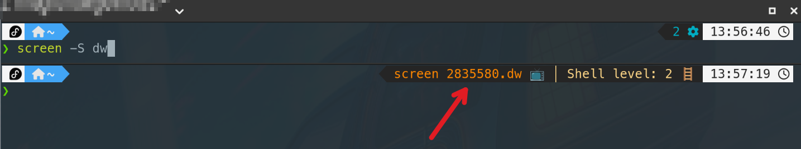
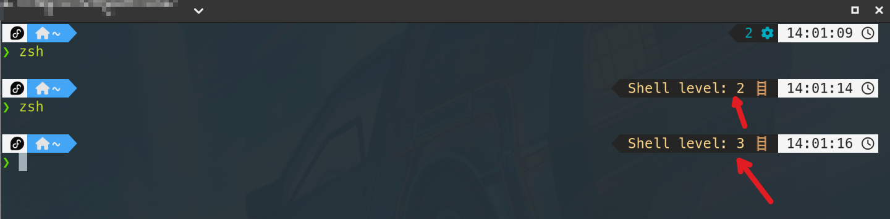

O objetivo é adicionar mais informações úteis ao prompt do zsh usando o tema Powerlevel10k. Informações customizadas que não são fornecidas por padrão pelo Powerlevel10k.

<!--more-->

## Antes de tudo

- Necessário ter o [Powerlevel10k](https://github.com/romkatv/powerlevel10k) instalado e configurado.
- Para qualquer alteração feita no arquivo `~/.p10k.zsh`, é necessário recarregar o zsh para que as alterações tenham efeito.

## Contexto do GNU Screen

Para mostrar quando estamos dentro de uma sessão do Screen, vamos adicionar um segmento customizado.

No arquivo `~/.p10k.zsh`, localize a definição de `POWERLEVEL9K_RIGHT_PROMPT_ELEMENTS` e adicione `screencontext`:

```zsh {hl_lines=[7]}
typeset -g POWERLEVEL9K_RIGHT_PROMPT_ELEMENTS=(
  # ... outros elementos ...
  # =========================[ Line #1 ]=========================
  status                  # exit code of the last command
  command_execution_time  # duration of the last command
  background_jobs         # presence of background jobs
  screencontext           # exibe um ícone informando que esta em uma sessão do GNU Screen
  # ...
)
```

E no final do arquivo, adicione a função que define esse segmento:

> Observar que a função tem que ser criada com o prefixo `prompt_` para que o Powerlevel10k reconheça e exiba corretamente.

```zsh {hl_lines=[1,2,3,4,5,6,7,8]}
  # GNU Screen context
  function prompt_screencontext() {
    # Verifica se a variável STY existe (definida pelo screen)
    if [[ -n "$STY" ]]; then
      # p10k segment: -f (cor da fonte), -i (ícone), -t (texto)
      p10k segment -f 208 -i '📺' -t "screen $STY"
    fi
  }

  # Daqui para baixo linhas já existentes (para servir de referência)

  # If p10k is already loaded, reload configuration.
  # This works even with POWERLEVEL9K_DISABLE_HOT_RELOAD=true.
  (( ! $+functions[p10k] )) || p10k reload
}
```



## Nível do subshell

Muitas vezes entramos em subshells sem perceber ou mesmo entramos por vontade própria. Para saber o nível de profundidade (SHLVL), vamos adicionar um segmento customizado.

No arquivo `~/.p10k.zsh`, localize a definição de `POWERLEVEL9K_RIGHT_PROMPT_ELEMENTS` e adicione `shlvl`:

```zsh {hl_lines=[4]}
  typeset -g POWERLEVEL9K_RIGHT_PROMPT_ELEMENTS=(
    # ...
    screencontext
    shlvl           # display subshell in prompt: https://github.com/romkatv/powerlevel10k/issues/2178
    # ...
  )
```

E no final do arquivo, adicione a função que define esse segmento:

```zsh {hl_lines=[1,2,3,4,5,6,7,8]}
  # Display subshell in prompt / Mostra o nível de profundidade da shell (SHLVL)
  function prompt_shlvl() {
    # Normalmente o nível 1 é o shell principal do terminal. Mostramos apenas se for nível 2 ou superior.
    if (( SHLVL > 1 )); then
      # p10k segment: -f (cor da fonte), -i (ícone), -t (texto)
      p10k segment -f 222 -i '🪜' -t "Shell level: $((SHLVL))"
    fi
  }

  # Daqui para baixo linhas já existentes (para servir de referência)

  # If p10k is already loaded, reload configuration.
  # This works even with POWERLEVEL9K_DISABLE_HOT_RELOAD=true.
  (( ! $+functions[p10k] )) || p10k reload
}
```



## Contexto do ArgoCD

Ver post [Contexto do ArgoCD no prompt PS1](/posts/2024-09-23-argocd-context-ps1-powerlevel10k/)
